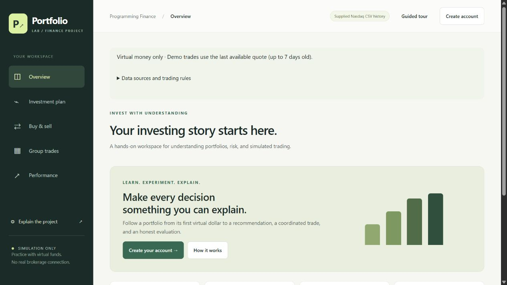
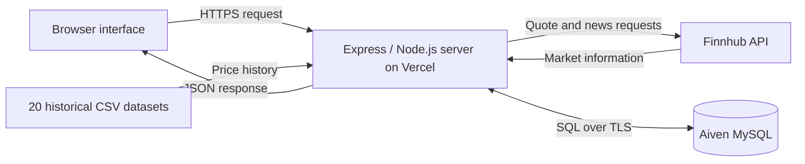

# Portfolio Lab

**A stock-trading simulator and portfolio analytics application built for the Programming Finance team project.**

## Live website

**[Open Portfolio Lab](https://portfolio-lab-one.vercel.app/)**

Explore 20 stocks, compare allocations, practise trades with virtual money, and evaluate historical outcomes. No real brokerage orders or bank transfers are made.



## Features

- **Practice portfolios:** create demo accounts, choose an investment horizon, add virtual funds, and track cash and whole-share holdings.
- **20-stock historical analysis:** supplied Nasdaq CSV files with 50,260 records, covering approximately October 2016 to October 2026.
- **Investment planning:** moving averages, RSI, covariance-based risk estimates, and a minimum-variance allocation with no short selling and a 20% maximum weight per stock.
- **Review before execution:** preview proposed trades and residual cash; save individual orders as pending, then approve or cancel them.
- **Simulated trading:** validate quote age, funds, holdings and portfolio ownership; commit account changes and execution records together.
- **Group trading:** coordinate orders across separately authorized portfolios while preserving individual balances and ownership.
- **Quotes and news:** Finnhub provides on-demand market information with timestamps, caching and bounded requests.
- **Performance comparisons:** compare a saved allocation with equal weights and original holdings. A separate SMA replay compares trend timing with buy-and-hold.
- **Guided interface:** company names, account switching, a guided tour, explanations and clear order feedback.

## Technology

| Layer | Implementation |
| --- | --- |
| Frontend | HTML, CSS and JavaScript |
| Backend | TypeScript, Node.js and Express 5 |
| Database | MySQL 8; hosted deployment uses Aiven with verified TLS |
| Market information | Finnhub API |
| Historical data | 20 bundled Nasdaq CSV files |
| Validation / calculations | Zod and decimal.js |
| Tests | Jasmine and Supertest |
| Hosting | Vercel |

## How it works



The browser presents the interface. The server validates requests, performs analysis and manages simulated transactions. MySQL stores accounts, portfolios, prices, recommendations, orders, executions and evaluations. Finnhub keys and database credentials stay on the server.

In CSV mode, historical analysis reads the bundled files and simulated execution uses Finnhub quotes. The news panel is informational; headlines do not automatically trigger trades.

## Run locally without Docker

### Requirements

- Node.js 22 (tested version; package supports Node 22-24)
- npm
- A running MySQL 8 server
- A Finnhub API key for quotes/news and CSV-mode simulated execution

### Install and configure

```sh
npm ci
```

Copy `.env.example` to `.env` (PowerShell: `Copy-Item .env.example .env`) and configure:

```dotenv
DB_HOST=127.0.0.1
DB_PORT=3306
DB_NAME=pf
DB_USER=your_database_user
DB_PASSWORD=your_database_password
TEST_DB_NAME=pf_test
MARKET_PROVIDER=csv
FINNHUB_API_KEY=your_finnhub_key
EXECUTION_MODE=demo-last-quote
PORT=3000
```

Create the `pf` database and give the application user access before migrating. For tests, create a separate `pf_test` database with appropriate access. Use your actual MySQL host and port; the optional bundled local setup uses port 3307.

```sh
npm run build
npm run migrate
npm start
```

Open **http://localhost:3000**. Keep the terminal running. Express serves the frontend and API together; no separate frontend build is required. On Windows, use `npm.cmd` if PowerShell blocks `npm.ps1`.

`npm run seed` optionally imports the configured historical series into MySQL. Analysis also loads price records when needed. Docker is optional and is not required for this setup.

### Try the workflow

1. Create a practice account and portfolio.
2. Add virtual funds.
3. Select 5-20 companies, an investment horizon, a cutoff date and a risk lookback.
4. Generate a recommendation and inspect risk estimates and target weights.
5. Preview trades or create an individual buy/sell order.
6. Approve the trade, then inspect cash, holdings and activity.
7. Evaluate the saved recommendation using later historical observations.

For a reproducible historical evaluation, use a cutoff within the supplied dataset, such as `2025-10-16`, and evaluate through `2026-10-02`.

## Configuration and assumptions

| Setting | Behavior |
| --- | --- |
| `MARKET_PROVIDER=csv` | Supplied historical data; Finnhub execution quotes |
| `MARKET_PROVIDER=offline` | Deterministic synthetic data for offline demonstrations |
| `EXECUTION_MODE=strict` | Simulated fills require quotes no more than five minutes old |
| `EXECUTION_MODE=demo-last-quote` | Hypothetical Finnhub fills may use quotes up to seven days old; timestamps are retained |
| `DB_SSL=true` | Enable verified TLS for hosted MySQL |
| `DB_SSL_CA` | Optional provider-specific PEM certificate authority |

The canned `npm run demo` workflow requires `MARKET_PROVIDER=offline`. For CSV mode, use the browser workflow above. An alternative Alpha Vantage adapter and optional external explanation-service adapter remain in the code; neither is required for the documented Finnhub + CSV setup. Without an external explanation service, commentary is deterministic.

## Testing

```sh
npm run typecheck
npm run test:unit
npm test
```

`test:unit` runs the configured domain specification without a database. The full suite needs a dedicated MySQL test database whose name ends in `_test`. Never point integration tests at the live application database. External provider behavior is tested with controlled responses; automated tests do not establish live-provider availability.

## Deploy to Vercel

The Vercel entry point is `src/index.ts`; local startup uses `src/server.ts`. Historical CSV files are included by `vercel.json`.

1. Provision a hosted MySQL database and apply migrations once.
2. Set database connection values, `DB_SSL=true`, `MARKET_PROVIDER=csv`, the Finnhub key and execution mode in Vercel environment settings.
3. Build and deploy the repository using the Express configuration.
4. Verify account creation, funding, analysis and a simulated trade after deployment.

See [deployment instructions](docs/vercel-deployment.md) for details. Do not commit `.env`, credentials or Vercel local project settings.

## Project structure

```text
public/          Browser interface
src/api.ts       Express routes and request validation
src/trading.ts   Portfolio, order and execution logic
src/analysis.ts  Recommendations and evaluations
src/domain.ts    Financial calculations
src/finnhub.ts   Quote/news client and cache
src/csv-market.ts Historical CSV provider
src/db.ts        MySQL connection and transaction helpers
data/nasdaq/     20 historical datasets
migrations/     Versioned database schema
tests/          Domain, API and integration tests
docs/           Design, API and deployment documentation
```

## Limits to understand

- This is an educational simulator, not a brokerage or production financial service.
- Estimated volatility measures historical fluctuations, not guaranteed returns or a maximum possible loss.
- The supplied history is approximately 10 years, not 20 years; its adjustment method is unverified.
- Allocation evaluation uses fractional analytical weights and zero costs. The separate SMA replay uses its own trading-cost assumptions. Neither is realized account profit.
- Demo identity tokens are stored in the browser. This is not production identity management or password recovery.
- Finnhub caching and request budgets are per server instance; they are not a shared distributed rate limiter.
- Source data availability, API entitlements, hosting limits and database plan availability can affect the live demo.

## Further documentation

- [API specification](docs/openapi.json)
- [Frontend guide](docs/frontend-guide.md)
- [Deployment guide](docs/vercel-deployment.md)

**[Launch the live demo](https://portfolio-lab-one.vercel.app/)**
